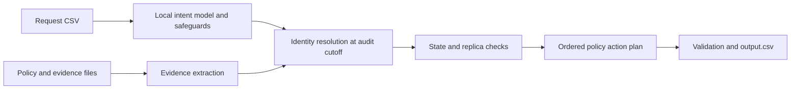

# Ghost Data Deletion Audit Agent

A local command-line agent that checks whether customer data was actually deleted instead of trusting a workflow's completion status.

Built for the [HackerRank Ghost Data challenge](https://github.com/interviewstreet/hackerrank-orchestrate-october26). It investigates current and historical identifiers across databases, replicas, logs, exports, PDFs, screenshots, and other supplied evidence, then produces an ordered remediation and verification plan.

**Prototype results:** 29/32 correct public statuses, 9/32 exact step sequences, and 8/8 synthetic safety tests. Verification coverage remains incomplete. The agent proposes actions; it never executes deletions.

## Features

- Distinguishes deletion requests from access, export, correction, and marketing-only requests.
- Reconstructs identity history and evidence available by the audit cutoff.
- Parses CSV, JSON, text, SQL snapshots, logs, PDFs, and screenshot pixels.
- Checks independent replicas, synchronization processes, and restore risks.
- Applies supplied rules to delete, redact, anonymize, or preserve records.
- Writes one `COMPLETE`, `INCOMPLETE`, or `NOT_APPLICABLE` result per request.

Qwen 2.5 1.5B runs locally through Ollama for intent classification. Python handles identity matching, evidence reconstruction, policy, and output validation. No paid API or API key is required; local hardware and electricity still have costs.

## Requirements

| Component | Requirement |
|---|---|
| Python | 3.10 or newer |
| Model runtime | [Ollama](https://ollama.com/) |
| Model | `qwen2.5:1.5b` |
| PDF extraction | PyMuPDF, installed below |
| Windows OCR | Windows OCR with an installed English language pack |
| Linux/macOS OCR | Tesseract CLI with English language data |

Development was tested on Windows with roughly 8 GB RAM. The Linux/macOS Tesseract fallback is implemented but was not tested during this submission.

## Quick start

Run commands from the repository root.

### 1. Install dependencies and the model

```sh
python -m pip install -r code/requirements.txt
ollama pull qwen2.5:1.5b
```

Start the Ollama application. If its server is not already running, start it in a separate terminal:

```sh
ollama serve
```

### 2. Add the dataset

The corpus is excluded from this repository. Obtain the participant-facing `dataset/` directory from the [original challenge repository](https://github.com/interviewstreet/hackerrank-orchestrate-october26) and place it beside `code/`:

```text
ghost-data-deletion-audit/
  code/
  dataset/
    deletion_requests.csv
    sample_deletion_requests.csv
    sample_output.csv
    user_identities.csv
    user_audit_log.csv
    system_activity.csv
    deletion_rules.csv
    evidence_files.csv
    evidence/
  README.md
```

### 3. Generate predictions

```sh
python code/main.py
```

This writes `output.csv` at the repository root. An uncached CPU run may take several minutes. Exact duplicate intent messages and extracted image text are cached outside `code/`.

You can keep the corpus elsewhere:

```sh
python code/main.py --dataset /path/to/dataset --output output.csv
```

Other options include `--requests`, `--cache`, `--model`, `--endpoint`, and `--usage-report`. Use an empty cache directory for cold-run token accounting.

The exact output schema is:

```text
case_id,deletion_status,steps_json
```

`steps_json` is an ordered JSON array of findings, remediation, and verification. Findings cite observed evidence. Proposed future actions have empty evidence IDs. Non-deletion requests receive `NOT_APPLICABLE` and `[]`.

### 4. Evaluate and test

```sh
python code/evaluation/main.py
python -m unittest discover -s code/evaluation -p test_cases.py -v
```

The evaluator expects `dataset/` at the repository root, including public sample answers, and updates the [evaluation report](code/evaluation/evaluation_report.md). Standalone synthetic tests need neither the corpus nor a running model.

## How it works



The engine treats reported workflow success as a claim, checks observation and capture timestamps, and preserves independent replica state. A missing primary record cannot override a surviving replica. Policy-required journals, legal holds, and permitted tombstone references are preserved.

## Measured results

These are development measurements against 32 public examples, not hidden-test accuracy.

| Metric | Result |
|---|---:|
| Correct statuses | 29/32 (90.62%) |
| Exact rows / ordered step sequences | 9/32 (28.12%) |
| Exact step precision | 100.00% |
| Exact step recall | 81.87% |
| Independent synthetic tests | 8/8 passing |

The 518-request submission read 94 evidence files. The model stage used 32 calls and 18,818 tokens with $0 API fees. Definitions, failures, and accounting are recorded in the [evaluation report](code/evaluation/evaluation_report.md) and [usage report](code/evaluation/usage_report.md).

## Known limitations

- The current linker misses some verification steps for absent or anonymized records.
- Reused emails and phone numbers lack ownership-interval disambiguation and mandatory corroboration. Name-only fallback also needs stronger safeguards.
- Ambiguous subject resolution currently aborts the batch instead of isolating that case.
- OCR and small-model intent predictions can be wrong. Explicit language safeguards help, but model-off and alternative-classifier comparisons were not performed.
- Conservative request-window filtering may omit older evidence that remains relevant.
- There is no explicit `UNKNOWN` or `NEEDS_REVIEW` output status. Unresolved cases can receive `INCOMPLETE` without invented findings.

Review proposed actions before operational use. A `COMPLETE` result is not a legal certification or a guarantee of exhaustive discovery.

## Project structure

| File | Purpose |
|---|---|
| `code/main.py` | CLI, OCR orchestration, validation, usage reporting |
| `code/audit.py` | Identity history, evidence parsing, temporal state, policy planning |
| `code/local_model.py` | Ollama client, prompt, intent safeguards, token accounting |
| `code/ocr_windows.ps1` | Windows OCR adapter |
| `code/evaluation/main.py` | Public evaluation and report generation |
| `code/evaluation/test_cases.py` | Eight synthetic safety tests |
| `code/package_submission.py` | Source/report ZIP packaging |

See [code/README.md](code/README.md) for additional implementation notes.

## Package the code

```sh
python code/package_submission.py
```

This creates `code.zip` with source and Markdown reports. The dataset, caches, model weights, virtual environments, generated predictions, and agent traces are excluded from GitHub and handled separately as local submission artifacts.

## AI assistance and provenance

Codex generated the architecture, implementation, tests, and documentation with user direction to use a free local model. Qwen is the application runtime for intent classification. The challenge specification and corpus originate from InterviewStreet/HackerRank. Public expected answers are used exclusively for evaluation, never prediction generation.
